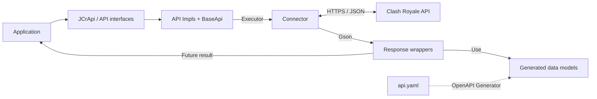

[](https://packagecloud.io/)
[](https://github.com/mlieshoff/jcrapi2/actions/workflows/nightlies.yml)

# jcrapi2 5.0.0

A Java client for the official Supercell Clash Royale API, with asynchronous
requests, generated data models, and optional filesystem caching.

Requires Java 21. See the [changelog](CHANGELOG.md) for the 5.0.0 breaking changes.

- [Installation](#installation)
- [Quick start](#quick-start)
- [Requests and responses](#requests-and-responses)
- [API reference](#api-reference)
- [Connectors and custom APIs](#connectors-and-custom-apis)
- [Migrating from 4.x](#migrating-from-4x)
- [Development](#development)
- [Community](#community)

## Installation

Add the packagecloud repository and dependency to your Maven project:

```xml
<repositories>
    <repository>
        <id>packagecloud-jcrapi2</id>
        <url>https://packagecloud.io/mlieshoff/jcrapi2/maven2</url>
    </repository>
</repositories>

<dependencies>
    <dependency>
        <groupId>jcrapi2</groupId>
        <artifactId>jcrapi2</artifactId>
        <version>5.0.0</version>
    </dependency>
</dependencies>
```

For Gradle:

```groovy
repositories {
    maven { url = uri('https://packagecloud.io/mlieshoff/jcrapi2/maven2') }
    mavenCentral()
}

dependencies {
    implementation 'jcrapi2:jcrapi2:5.0.0'
}
```

## Quick start

Create an API token through the [Clash Royale developer portal](https://developer.clashroyale.com/)
and make it available as the `CLASH_ROYALE_TOKEN` environment variable.
The standard connector adds the Bearer authorization header to requests.

```java
import jcrapi2.JCrApi;
import jcrapi2.api.intern.cards.CardApi;
import jcrapi2.api.intern.cards.CardsRequest;
import jcrapi2.api.intern.cards.CardsResponse;
import jcrapi2.essentials.connector.StandardConnector;

public class Example {
    public static void main(String[] args) throws Exception {
        String apiKey = System.getenv("CLASH_ROYALE_TOKEN");
        if (apiKey == null || apiKey.isBlank()) {
            throw new IllegalStateException("Set CLASH_ROYALE_TOKEN before running this example");
        }

        JCrApi jCrApi = new JCrApi(
                "https://api.clashroyale.com/v1", apiKey, new StandardConnector());
        CardApi cards = jCrApi.getApi(CardApi.class);
        CardsResponse response = cards.findAll(
                CardsRequest.builder().storeRawResponse(true).build()).get();

        response.getItems().forEach(card -> System.out.println(card.getName()));
    }
}
```

Use `jCrApi.listApis()` to list registered API interfaces. The following examples
assume you already have a `JCrApi` instance named `jCrApi`.

## Requests and responses

### Tagged resources

Pass the tag or ID to the request builder. The connector URL-encodes path
parameters, so a player tag can include its leading `#`.

```java
import jcrapi2.api.intern.players.PlayerApi;
import jcrapi2.api.intern.players.info.PlayerRequest;
import jcrapi2.api.intern.players.info.PlayerResponse;

PlayerApi players = jCrApi.getApi(PlayerApi.class);
PlayerResponse player = players.findByTag(
        PlayerRequest.builder("#2PGGCJJL").storeRawResponse(true).build()).get();
```

### Pagination

Pagination requests expose `limit`, `after`, and `before`. Follow a response's
paging cursor with either `after` or `before` in the next request.

```java
import jcrapi2.api.intern.clans.ClanApi;
import jcrapi2.api.intern.clans.ClansRequest;
import jcrapi2.api.intern.clans.ClansResponse;

ClanApi clans = jCrApi.getApi(ClanApi.class);
ClansResponse page = clans.findAll(
        ClansRequest.builder().name("Royal").limit(5).build()).get();

if (page.getPaging() != null && page.getPaging().getCursors() != null) {
    String after = page.getPaging().getCursors().getAfter();
    if (after != null) {
        ClansResponse nextPage = clans.findAll(
                ClansRequest.builder().name("Royal").limit(5).after(after).build()).get();
    }
}
```

### Events and list responses

Some responses, including events, battle logs, and challenges, are lists directly.
Events contain generated `TrailEvent` models; their descriptions can be null.

```java
import jcrapi2.api.intern.events.EventApi;
import jcrapi2.api.intern.events.EventsRequest;
import jcrapi2.api.intern.events.EventsResponse;

EventApi events = jCrApi.getApi(EventApi.class);
EventsResponse response = events.findAll(EventsRequest.builder().build()).get();
response.forEach(event -> System.out.println(event.getTitle()));
```

### Asynchronous calls, errors, and raw responses

API methods return `java.util.concurrent.Future<T>`. Calling `.get()` waits for
the result; you can also use the overload with a timeout. A failed HTTP request
is reported as a `ConnectorException` wrapped in an `ExecutionException` when
awaiting the future.

Set `.storeRawResponse(true)` on a request to retain the response JSON and
headers in `response.getRawResponse()`. Raw-response storage is disabled by
default. The library uses SLF4J for logging.

## API reference

The interfaces below link to their request and response signatures.

| API | Methods |
| --- | --- |
| [CardApi](src/main/java/jcrapi2/api/intern/cards/CardApi.java) | `findAll` |
| [EventApi](src/main/java/jcrapi2/api/intern/events/EventApi.java) | `findAll` |
| [PlayerApi](src/main/java/jcrapi2/api/intern/players/PlayerApi.java) | `findByTag`, `getUpcomingChests`, `getBattleLog` |
| [ClanApi](src/main/java/jcrapi2/api/intern/clans/ClanApi.java) | `findAll`, `findByTag`, `getMembers`, `getRiverRaceLog`, `getCurrentRiverRace` |
| [TournamentApi](src/main/java/jcrapi2/api/intern/tournaments/TournamentApi.java) | `findAll`, `findByTag` |
| [LocationApi](src/main/java/jcrapi2/api/intern/locations/LocationApi.java) | `findAll`, `findById`, `getClanRankings`, `getPlayerRankings`, `getClanWarRankings`<br>`getTopPlayerLeagueSeasons`, `getTopPlayerLeagueSeason`, `getTopPlayerLeagueSeasonRankings`<br>`getTopPlayerPathOfLegendSeasonRankings`, `getTopPlayerPathOfLegendRankings`, `getTopPlayerTournamentRankings`, `getTopPlayerLeagueSeasonsV2` |
| [ChallengeApi](src/main/java/jcrapi2/api/intern/challenges/ChallengeApi.java) | `findAll` |
| [GlobalTournamentApi](src/main/java/jcrapi2/api/intern/globaltournaments/GlobalTournamentApi.java) | `findAll` |
| [LeaderboardApi](src/main/java/jcrapi2/api/intern/leaderboards/LeaderboardApi.java) | `findAll`, `findById` |

Some legacy endpoints have unavailable data or return errors. The
[fixture notes](src/test/resources/README.md) record the observed endpoint status
and distinguish current responses from older populated samples.

## Connectors and custom APIs

### Standard and cached connectors

`StandardConnector` performs HTTP requests and deserializes JSON with Gson.
`FilesystemCachedConnector` caches successful, non-empty responses for five
minutes under `java.io.tmpdir`, using the supplied directory prefix.

```java
import jcrapi2.essentials.connector.Connector;
import jcrapi2.essentials.connector.FilesystemCachedConnector;

Connector connector = new FilesystemCachedConnector("jcrapi2");
```

### Custom connectors

Implement `jcrapi2.essentials.connector.Connector` to customize transport or wrap
an existing connector. A delegating implementation looks like this:

```java
import jcrapi2.essentials.common.IResponse;
import jcrapi2.essentials.connector.Connector;
import jcrapi2.essentials.connector.ConnectorException;
import jcrapi2.essentials.connector.RequestContext;
import jcrapi2.essentials.connector.StandardConnector;

Connector delegate = new StandardConnector();
Connector connector = new Connector() {
    @Override
    public <T extends IResponse> T get(RequestContext context) throws ConnectorException {
        return delegate.get(context);
    }
};
```

`RequestContext` is a record with `url()`, `apiKey()`, `request()`, and
`responseClass()` accessors. A connector that performs HTTP calls itself must
apply the request parameters, send Bearer authorization, deserialize the response,
and honor the raw-response flag.

### Custom APIs

Your API interface extends `jcrapi2.essentials.api.Api`. Its implementation extends
`jcrapi2.essentials.api.BaseApi` and has a constructor taking `ApiContext`.
Register the implementation before requesting an instance:

```java
jCrApi.register(MyApi.class, MyApiImpl.class.getName());
MyApi api = jCrApi.getApi(MyApi.class);
```

### RoyaleAPI proxy

To use the RoyaleAPI proxy, follow its
[setup instructions](https://docs.royaleapi.com/#/proxy) and pass
`https://crproxy.royaleapi.dev/v1` as the base URL when constructing `JCrApi`.

## Migrating from 4.x

- Essentials classes now live under `jcrapi2.essentials`; the external Supercell
  essentials dependency has been removed.
- Response payloads use generated classes from `jcrapi2.api.generated.model`.
  Update imports that referred to the removed handwritten DTOs.
- Nested getters can return different types, including enums instead of strings.
  Player progress is a `Map<String, TrophyRoadProgress>` with dynamic keys.
- Existing API interfaces, request builders, futures, pagination, and raw-response
  handling remain in place.

See [CHANGELOG.md](CHANGELOG.md) for the release details.

## Development

Building requires Java 21 and Maven 3.8.8 or later.

### Architecture



`JCrApi` registers and creates API implementations. `BaseApi` submits connector
calls to a shared executor and returns a future. The connector builds the HTTP
request and deserializes its response into wrappers backed by generated models.
The bundled essentials code lives under `jcrapi2.essentials`.

### Generated API data classes

[`src/main/resources/api.yaml`](src/main/resources/api.yaml) defines the data
models. Maven runs OpenAPI Generator 7.10.0 during `generate-sources`:

```bash
mvn generate-sources
```

Generated Java sources go to `target/generated-sources/openapi/src/main/java`,
using the package `jcrapi2.api.generated.model`, and are compiled into the JAR.
The generator uses Java `feign` templates with Gson serialization for standalone
POJOs. API clients and supporting files are disabled; the generated models have
no Feign runtime dependency. Edit `api.yaml` and regenerate to update models.

Object response wrappers extend generated models; paginated and list responses
use generated elements. For example, `CardsResponse` extends generated `Items`,
and `getItems()` returns `List<jcrapi2.api.generated.model.Item>`.

The schema uses API enum values such as `inviteOnly`, `singleChallenge`, and
`elder`; enum parsing also ignores case. Absent arrays remain null. Localized
names are strings, icons use `IconUrls`, and dynamic player-progress values use
`TrophyRoadProgress`.

### Formatting and tests

```bash
mvn spotless:apply
mvn spotless:check
mvn test
```

The default suite runs unit tests and WireMock integration tests without a live
API key. Fixture collections contain at most five entries, with separate cases
for empty, null, and populated responses. The shared assertions check generated
payload types, raw responses, and preservation of non-null JSON fields.
See the [fixture documentation](src/test/resources/README.md) for data provenance.

Live tests are opt-in through the `endToEnd` Maven profile. Configure the endpoint
and sample identifiers in [EndToEnd.java](src/test/java/jcrapi2/EndToEnd.java), set
`API_KEY`, then run:

```bash
mvn -PendToEnd test
```

See [AGENTS.md](AGENTS.md) for contributor and coding-agent instructions.
Dependency and plugin updates should be reviewed deliberately against the
configured versions in [pom.xml](pom.xml).

## Community

- [Discord](https://discord.gg/WNb5c8hn)
- [GitHub repository and issues](https://github.com/mlieshoff/jcrapi2)
- [Continuous integration](https://github.com/mlieshoff/jcrapi2/actions)
- [Package repository](https://packagecloud.io/mlieshoff/jcrapi2)
